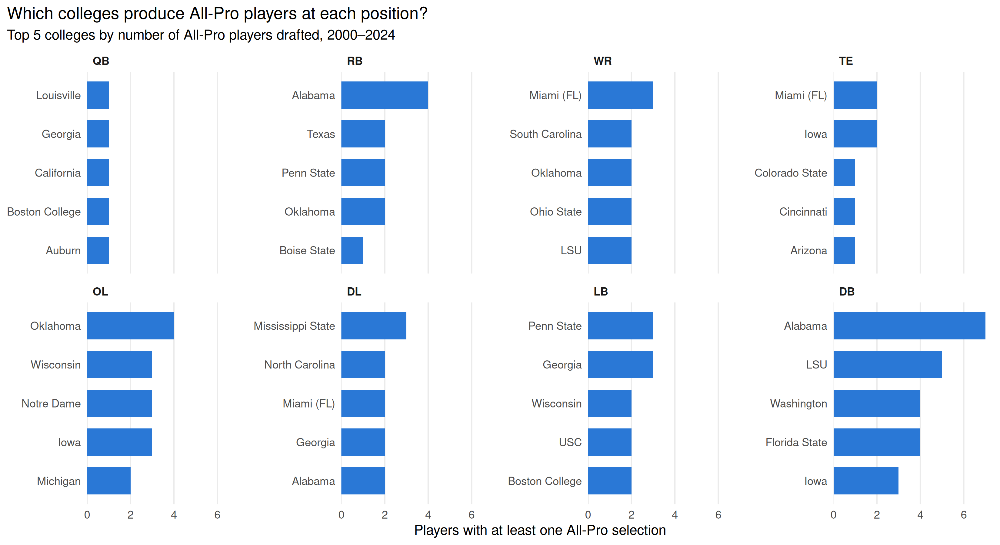

# Cleaning 25 Years of NFL Draft Data (2000–2024)

This project scrapes every NFL draft from 2000 to 2024 from Wikipedia, cleans it, and joins it with career honors data from `nflreadr`. The cleaned data is used to show which colleges have produced the most All-Pro players at each position.

## Data sources

| Source | What it provides | Format |
|---|---|---|
| Wikipedia yearly NFL draft pages (e.g. `https://en.wikipedia.org/wiki/2010_NFL_draft`) | Every pick: round, pick number, team, player, position, college, Pro Bowl (†) and Hall of Fame (‡) markers | HTML pages, about 13 tables each |
| `nflreadr::load_draft_picks()` (Pro Football Reference data) | All-Pro selections, Pro Bowl count, Hall of Fame flag | R data frame |

## Why this data is messy

- **Unstructured:** the draft data lives in HTML pages, not a data file. Each page has around 13 tables, and the picks table is not in the same position every year.
- **Multiple sources:** Wikipedia and nflreadr use different conventions (full team names vs abbreviations like `STL`, `pos` vs `position`, different spellings of player names).
- **Inconsistent names:** 311 player names differ between the two sources, positions use 22 different labels (`S` vs `FS`/`SS`, `LB` vs `ILB`/`OLB`), and one college appears under two names (`UConn` and `Connecticut`).
- **Structural and multiple types of missing values:** placeholder rows for forfeited picks where no player was drafted, plus empty strings (`""`) and `NA` both used for missing values.
- **Multiple values in one column:** the round column holds the round number and the pick type (`"7*"`), and the player column holds the name plus Pro Bowl and Hall of Fame markers (`"Ndamukong Suh †"`).

## Repository structure

```
├── clean_draft.R                         # full scraping and cleaning script
├── README.md                             # this file / cleaning log
├── data/
│   ├── raw/wikipedia_draft_raw.rds       # untouched scraped tables
│   └── clean/nfl_draft_2000_2024_clean.csv
└── figures/
    └── top_colleges_allpro.png
```

## How to reproduce

Install the packages once:

```r
install.packages(c("rvest", "dplyr", "stringr", "janitor", "purrr",
                   "tidyr", "nflreadr", "ggplot2", "tidytext"))
```

Then run `clean_draft.R` from top to bottom. It scrapes the pages, saves the raw data, cleans and joins it, saves the clean CSV, and saves the figure.

## Cleaning log

### Starting with 2010

- I decided to work with just 2010 first to get it working before turning it into a repeatable program later so that I could handle issues on a smaller scale.

- After downloading the data, I started by using lapply to get the size of each table to locate where the draft table is since it would be the largest.

- The scraped table had two unnamed columns that were entirely NA, left over from Wikipedia’s table formatting, so I dropped them.

- Column names had punctuation and mixed case (Rnd., Pos.). I used janitor::clean_names() to make them lowercase with no punctuation because formatted names are easier to work with.

- Wikipedia marks Pro Bowlers by adding a † to the player’s name, so two pieces of information share one column. I created a boolean pro_bowl column, then removed the † and the extra space from the name, so that the column is formatted and the pro bowls are easier to count.

- The round column combined the round number with symbols marking compensatory (*) and supplemental compensatory (^) picks, so it was stored as text. In response, I created a pick_type column from the symbols, then kept only the number in round and converted it to an integer. I did this so I could count it later.

- One row was a placeholder: selection forfeited in 2009 supplemental draft. They lost this pick and it is not useful, so I dropped the row. This makes the data cleaner to navigate.

### All 25 years

- Now that the 2010 set was tested on how to clean on, I am going to make a function that works for all years.

- Each Wikipedia draft page has around 13 tables, and the picks table isn’t in the same position every year, so I wrote a function that searches each page for the table whose column names include pick and player, keeping the largest match.

- I saved the untouched scraped tables to data/raw/wikipedia_draft_raw.rds. I did this because Wikipedia pages can be edited at any time, so saving the raw data keeps the results reproducible and means that I can rerun without scraping again.

- The same cleaning had to run on 25 separate tables. Some years had an extra empty column, and the Pick column was stored as a number in some years and as text in others. To fix this, I put the cleaning steps into one function, converted every column to text before cleaning, and stacked the results into a single table with a year column. This makes all 25 years uniform to join into one table

- Not every year had the same number of picks, so I checked that each year’s picks ran from 1 up to the number of rows, with no gaps or duplicates. I did this to make sure I didn’t drop any important rows.

### Player names

- Wikipedia marks Hall of Famers with ‡ instead of †, so they were being counted as non-Pro Bowlers, so I created a hall_of_fame column from ‡ and counted either † or ‡ as a Pro Bowl selection. Then removed both symbols from the names. If I didn’t do this, the best players in the data would have been marked as non-Pro Bowlers.

- About 100 names came through as something like "Chustz, JoeyJoey Chustz". I used a regex that only matches when the first name appears twice and kept only the displayed First Last part. If I didn’t, I’d have a hard time joining with the all pro data source later.

- 13 names contain accented letters (Donté Stallworth, Pierre Garçon, Björn Werner). Kept them as they are. Removing the accents would make the data less accurate, and the join uses year and pick number rather than names.

- One name included a quoted nickname (Greg "Stylez G." White), and one used an en dash (–) instead of a hyphen in a hyphenated last name. I removed text in quotes from names and replaced en dashes with hyphens. A nickname is extra information packed into the name field. The en dash looks identical to a hyphen but is a different character, so it would make the same name look different when comparing with the second source.

### Positions

- The same position appears under different labels across years and pages (S vs FS/SS, LB vs ILB/OLB, DT vs NT, TE/FB), and 22 labels are too many to compare. To make it simpler, I kept the original pos column and added pos_group with 9 groups: QB, RB, WR, TE, OL, DL, LB, DB, ST because grouping puts differently labeled versions of the same role together. Keeping the original column makes sure no detail is lost. Any unlisted label becomes NA instead of being silently assigned to a group, so new labels get caught. I noticed edge rushers are listed as DE on some teams and OLB on others, depending on the team’s defensive scheme, so some similar players land in different groups.

- Specific labels (FS, SS, ILB, OLB, NT, TE/FB) appear in 11 of the 25 years, usually for only one or two players. The standard labels are S, LB, and DT, so the specific ones are inconsistent entries, not a change in convention.

### Colleges

- The University of Connecticut appeared as both Connecticut (21 picks) and UConn (9 picks), which would split its count in two, and three small schools used an en dash instead of a hyphen (CSU–Pueblo, Concordia–St. Paul, UW–Stout). To make sure the counts were accurate, I renamed UConn to Connecticut, the more common spelling in the data, and replaced en dashes with hyphens.

### Joining the second source

- Wikipedia doesn’t record All-Pro selections, which are the measure of an elite career for this project, so I joined nflreadr::load_draft_picks() (Pro Football Reference data) on year and overall pick number, keeping the All-Pro count, Pro Bowl count, Hall of Fame flag, and nflreadr’s own name, team, position, and college for comparison. nflreadr columns were prefixed with nfl_. Year and pick number identify each pick exactly, while names are spelled differently between sources. The two sources use different conventions (team abbreviations vs full names, position vs pos), so the join had to be something both record the same way.

- The join added no rows. Every Wikipedia pick matched an nflreadr pick and reverse. Round numbers agreed for all 6,387 picks. Allpro had no missing values.

### Comparing the two sources

- Pro Bowl comparison: Wikipedia’s †/‡ markers and nflreadr’s Pro Bowl counts agreed for 6,379 of 6,387 picks (99.9%). The 8 disagreements are listed in the output. The round agreement confirms the year + pick key lined the sources up correctly. The few Pro Bowl disagreements show that Wikipedia’s markers depend on editors keeping pages updated, which is why All-Pro counts come from nflreadr.

- The two sources disagree on 8 players, in both directions. Errors from both sources suggests Wikipedia’s markers depend on editors updating each page, which supports using nflreadr for career honors.

- 6,076 names matched. 235 differed only in formatting like initials spacing, accents vs apostrophes and suffixes, and 76 were different names like nicknames and legal name changes. This confirms a name join would’ve failed.

## Final figure



- To showcase my cleaning, I mapped the top 5 colleges with the most all pros in the nfl for each position group. Special teams were left out because there are few kickers, punters, and long snappers.
